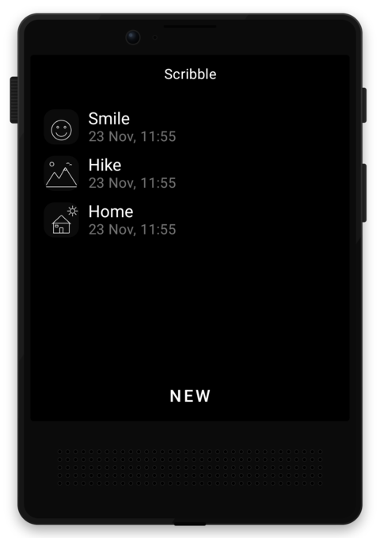
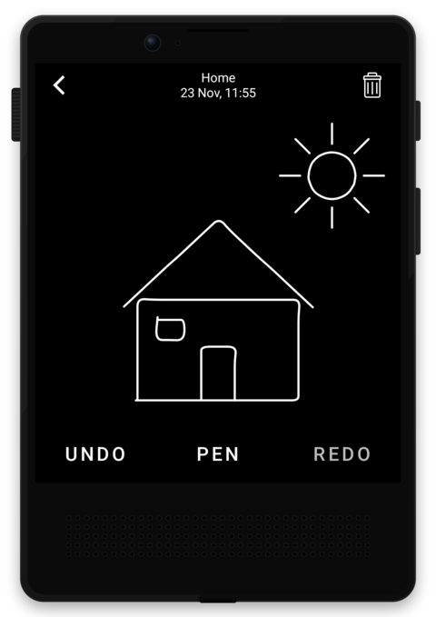
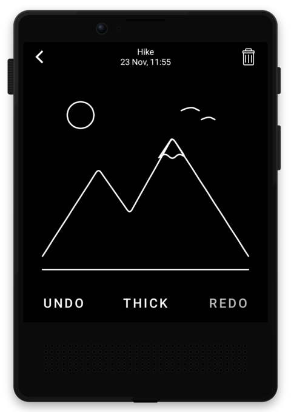

# Scribble

A plain sketchpad for the Light Phone III. Draw with your finger, undo, and come back to it later.

<p align="center">
  
  
  
</p>

- Three brushes: pen, thick pen and eraser. Tap the middle button at the bottom to switch. On the phone the scroll wheel switches too.
- Unlimited undo and redo, also on volume down and volume up.
- Every sketch is saved as you draw and exported as a PNG (black on white). Download them from a computer through the Tool Manager, under Scribble → Sketches.
- Name a sketch by tapping its title. The list shows a small picture of each one, with its name and date.
- One page, one brush at a time: no colours, layers, feeds or sharing. An empty page is never kept.

## Privacy

No account, no tracking, no analytics, no ads, and no network access: the tool requests no permissions. Sketches stay on the phone until you download them yourself with the Tool Manager.

## License

MIT, see `LICENSE`.

## Build

This repo holds only the `tool/` module. Copy it into a checkout of [light-sdk](https://github.com/lightphone/light-sdk), replacing its `tool/`, then:

```sh
./gradlew :tool:testDebugUnitTest :tool:assembleRelease
```
